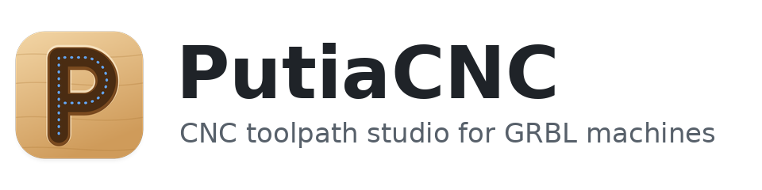

<picture>
  <source media="(prefers-color-scheme: dark)" srcset="docs/banner-dark.png">
  
</picture>

**Project page: <https://tonyrh.github.io/putiacnc/>**

A CNC toolpath studio for GRBL machines (with Mach3 / LinuxCNC output too), written in Rust. Draw or import shapes, assign operations
(profile, pocket, V-carve, drill, inlay), preview the result in 2D and in a simulated 3D view of the machined
stock, and export G-code. Projects are saved as JSON files (`"app": "putia-cnc"`).

*2D design: draw or import shapes, assign them to profile, pocket, V-carve or drill operations, and set depth, tabs and tools.*

*3D preview: the toolpath is replayed on the stock (shown here once every operation has run), so you can check the result before sending the G-code to the machine.*

https://github.com/user-attachments/assets/125b44a8-97f7-4a43-9ab0-32ccd8410e06

*The 3D preview replaying a job: the cutter follows the toolpath and the stock is carved as it goes ([full-quality video](docs/demo.mp4)).*

The workspace has two crates:

- **`putiacnc-core`** (this folder): project model, geometry, SVG and DXF import, the material-removal
  simulation and G-code generation. It has no GUI dependency and also builds a command-line tool.
- **`putiacnc-gui`** (`gui/`): the desktop app, built with egui/eframe (OpenGL).

## The desktop app

**Download:** the [Releases page](https://github.com/tonyrh/putiacnc/releases) has an AppImage for Linux, a disk image for macOS and a portable zip for Windows. To build it yourself, see [Build from source](#build-from-source).

### Features

**Drawing**
- Rectangles, ellipses, lines, polygons, stars, bolt circles, point grids, and text in any installed font or in a built-in single-line font for pen drawing (text stays editable).
- Import SVG, DXF, bitmaps (traced into outlines or centre lines), and STL / OBJ models for 3D relief.
- Object snap, typed values while drawing, node editing, trim and extend, fillet and chamfer, offset, combine (union, subtract, intersect), align, array, rotate, clean up broken outlines.

**Operations**
- Profile (outside, inside, on the line), pocket, V-carve, drill, inlay and 3D relief, each with its own tool, depth, pass depth, cut direction, ramp-in, holding tabs, lead-in / lead-out and air cut.
- Flat, bull, ball, V-bit, engraving, tapered ball and arc profile bits, shown with their real shape in the 3D preview.

**Preview and checks**
- A 2D canvas and a simulated 3D view of the machined stock, with a view cube and a play bar that replays the job.
- Toolpath warnings run in the background: too deep for the cutter, cutting into the table, outside the machine area, rapids through material, shank rubbing, clamps (keep-out zones you can drag), and cuts that stray from your drawing. The G-code is always written; the warnings only inform.

**Tools and machines**
- Tool libraries with imperial and metric bits, a chip-load estimate, search, and ready-made libraries (CMT, Amana, Bosch, Freud, Whiteside, Diablo, generic, and pens and markers for plotting) in `libraries/`.
- Machine profiles: work area, GRBL or Mach3 / LinuxCNC dialect, units, line numbers, G2/G3 arcs, safe Z, spindle and feed limits, and your own start and end G-code. Export and import them as files.

**Everything else**
- G-code tab with a time estimate, optional inches and line numbers; project notes; keyboard shortcuts (F1); light and dark themes; check for updates (only when you ask); window and panel layout remembered between sessions.

The full list, with every option, is in [docs/features.md](docs/features.md).

### Build from source

PutiaCNC needs Rust 1.75 or newer and a C++ compiler (the Clipper library is C++, built by the `cc` crate). Install Rust from [rustup.rs](https://rustup.rs). Then, on any system:

    cargo run --release -p putiacnc-gui
    cargo run --release -p putiacnc-gui -- path/to/project.json

The program is called `putiacnc`. Your tool and machine libraries are stored per user (set `PUTIACNC_CONFIG_DIR` to use another folder).

#### Linux

- Install a C++ compiler, `pkg-config` and the OpenSSL development files (`libssl-dev` on Debian and Ubuntu, `openssl-devel` on Fedora); the window needs the usual X11 or Wayland and OpenGL libraries.
- Libraries are kept in `~/.config/putiacnc` (or `$XDG_CONFIG_HOME/putiacnc`).
- `packaging/install.sh` installs the build for your user: the program in `~/.local/bin`, a menu entry and the icons (`--uninstall` removes them). Run it on Wayland (Hyprland, Sway, GNOME): there the window cannot carry its own icon, so taskbars and launchers find it through the menu entry.

#### macOS

- Install the Xcode command line tools (`xcode-select --install`), which include the C++ compiler. No other libraries are needed.
- Libraries are kept in `~/Library/Application Support/PutiaCNC`.
- The released disk image is ad-hoc signed but not notarized, so on first launch right-click the app and choose Open (or allow it in System Settings → Privacy & Security).

#### Windows

- Install the [Visual Studio Build Tools](https://visualstudio.microsoft.com/downloads/) with the "Desktop development with C++" workload, then Rust (the default MSVC toolchain). No other libraries are needed.
- Libraries are kept in `%APPDATA%\PutiaCNC`.
- The released zip is portable: unzip it and run `PutiaCNC.exe`. It is not code-signed, so SmartScreen may warn the first time ("More info" → "Run anyway").

### Packaging (for maintainers)

- **Linux AppImage:** built by the release workflow on a `v*` tag (on Ubuntu 22.04, so it runs on any distribution with that glibc or newer); to build it by hand, run `packaging/build-appimage.sh`. It bundles `LICENSE` and `THIRD-PARTY-LICENSES.txt` (regenerate the latter with `cargo about generate --workspace about.hbs`) and needs a glibc as new as the machine that built it.
- **macOS disk image** (universal, Apple silicon and Intel): `packaging/build-dmg.sh` on a Mac.
- **Windows zip** and the other release files are built by the GitHub Actions workflow in `.github/workflows/release.yml` when a `v*` tag is pushed.
- The app icon is in `assets/` (`putiacnc.svg`, PNGs from 16 to 512 px, and `putiacnc.ico`, which is embedded in the Windows exe). It is also set as the window icon on every platform.
- `cargo run --release --example sign` builds a sample sign and times toolpath generation and the 3D replay.

## Command line

    cargo run --release --bin putia-gcode -- project.json [--imperial] [-o out.nc]

---

# putiacnc-core

The calculation core of PutiaCNC, in Rust: project model, geometry and GRBL G-code generation.
It turns a project into GRBL G-code; its output is pinned by snapshot tests and checked by an independent G-code verifier.

## What's in it

| File | Purpose |
|---|---|
| `src/model.rs` | Data model (serde). Reads and writes the project files (`"app": "putia-cnc"`). |
| `src/clip.rs` | Safe wrapper around Clipper 6.4 (Clipper 6.4): even-odd union, round-join offset, cleaning, area. |
| `src/toolpath.rs` | Profile (outside / inside / on line), pocket, V-carve, drill, inlay pocket and plug, tabs, ramping, tool shapes, tool changes, units, work zero / Z zero, time estimate. |
| `src/svg.rs` | SVG import into closed and open shapes. |
| `src/bitmap.rs` | Bitmap import: threshold, trace outlines and holes into closed shapes. |
| `src/dxf.rs` | ASCII DXF import (lines, arcs, circles, polylines, splines, blocks). |
| `src/sim.rs` | Height-field material-removal simulation used by the 3D preview. |
| `src/bin/putia-gcode.rs` | Command line: `putia-gcode project.json [--imperial] [-o out.nc]` |
| `tests/golden.rs` | Golden tests: snapshots of the generator's own output. |
| `tests/data/` | Eight projects with their reference G-code and time estimate. |

Also in the core: SVG and DXF import (`src/svg.rs`, `src/dxf.rs`), shape helpers (`src/shapes.rs`), tool and machine libraries (`src/toollib.rs`, `src/machines.rs`) and the height-field simulation behind the 3D preview (`src/sim.rs`).

## Build and test

Needs Rust 1.75 or newer and a C++ compiler (Clipper is C++, built by the `cc` crate).

    cargo test
    cargo run --release --bin putia-gcode -- tests/data/tabs.project.json -o tabs.nc

If `cargo` fails with "Permission denied" running a build script, your project folder is on a
no-exec mount. Build elsewhere: `CARGO_TARGET_DIR=/tmp/putia-target cargo test`.

## Golden tests

Each scenario in `tests/data` has `NAME.project.json` (a saved project), `NAME.snapshot.nc` (the reviewed
G-code) and `NAME.snapshot.json` (units, time estimate). The test regenerates the G-code and compares it with the
snapshot: same lines, coordinates within 0.0011 mm.

When you change the generator on purpose, run `UPDATE_SNAPSHOTS=1 cargo test --test golden`, read
`git diff tests/data` and commit what you accept. The snapshots started as the output of the old browser app
(identical apart from the lift to safe Z, and extra finishing rings in the V-carve centre); they are
now this project's own. To add a scenario, save a project from the app into `tests/data`, add a one-line test in `golden.rs` and run the update command.

## Notes

- Lengths are millimetres, feeds are mm/min, loop points are integers in 1/1000 mm (Clipper's scale).
- G-code numbers are formatted to match the reference output exactly (fixed decimals, shortest form for integers).
- Offsets that collapse a shape are very slow in Clipper. Repeated offsets (pocket rings, V-carve rings)
  therefore offset the previous ring by one step instead of offsetting the original shape by a growing distance.

Help → About shows the version, licence, links, and buttons to open the config folder and copy version info for a bug report (version, system and kernel, desktop session, CPU and memory, window scale, graphics driver, config folder; no user or computer name).

## Trademarks and bit data

Amana Tool, Bosch, CMT, Diablo, Freud and Whiteside are trademarks of their owners. PutiaCNC is not affiliated with or endorsed by
them; the names are used only to say which bits the ready-made library entries match. The libraries hold part numbers and dimensions
taken from the makers' published catalogs, booklets and web pages. The feeds, speeds and notes are the author's own conservative
starting values, not the makers' recommendations. If you are a rights holder and want a library or a bit removed or corrected,
open an issue on GitHub.

## License

PutiaCNC is free software, released under the GNU General Public License v3.0 or later. See `LICENSE`.
