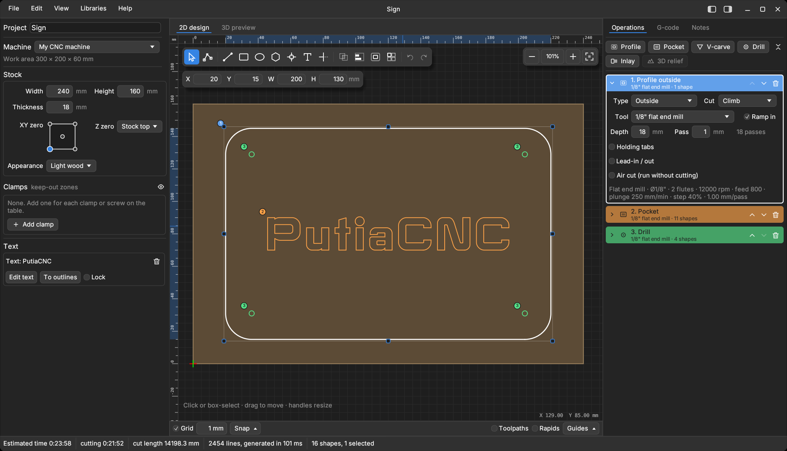
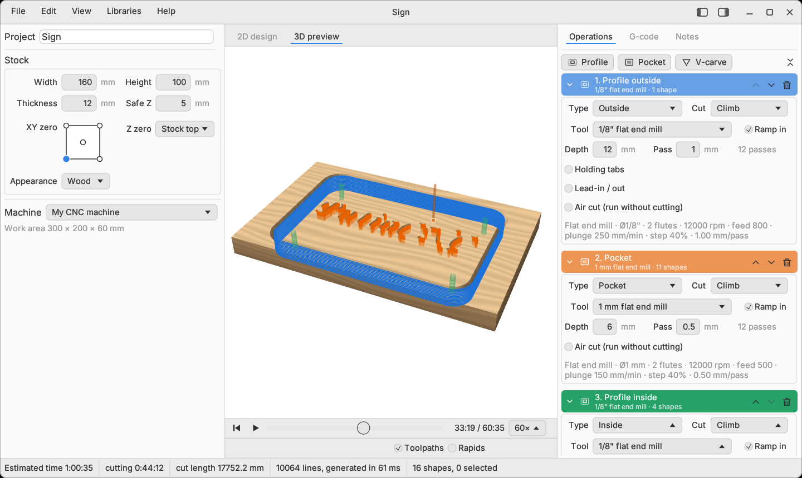

# PutiaCNC

A CNC toolpath studio for GRBL machines (with Mach3 / LinuxCNC output too), written in Rust. Draw or import shapes, assign operations
(profile, pocket, V-carve, drill, inlay), preview the result in 2D and in a simulated 3D view of the machined
stock, and export G-code. Projects are saved as JSON files (`"app": "putia-cnc"`).

*2D design: draw or import shapes, assign them to profile, pocket, V-carve or drill operations, and set depth, tabs and tools.*

*3D preview: the toolpath is replayed on the stock, so you can check the result before sending the G-code to the machine.*

https://github.com/user-attachments/assets/0fcbaebb-aa6b-4d2a-b85b-e031ee82d803

*The 3D preview replaying a job: the cutter follows the toolpath and the stock is carved as it goes ([full-quality video](docs/demo.mp4)).*

The workspace has two crates:

- **`putiacnc-core`** (this folder): project model, geometry, SVG and DXF import, the material-removal
  simulation and G-code generation. It has no GUI dependency and also builds a command-line tool.
- **`putiacnc-gui`** (`gui/`): the desktop app, built with egui/eframe (OpenGL).

## The desktop app

Features:

- 2D design canvas: rectangles, ellipses, lines and polygons, SVG and DXF import (File → Import Vectors), select / move / resize,
  snapping, undo and redo (Edit → Undo steps back through any change; the toolbar buttons only undo drawing changes), align to the stock and to each other, distribute (the Align button in the tool palette; it is greyed out until something is selected). The node tool (N, or double-click a
  shape) edits its points: drag, add, delete and simplify. Edit → Offset grows or shrinks
  the selected shapes by a distance (inlays, clearances); Edit → Combine shapes does union, subtract, intersect
  and exclude. The text tool (T) turns typed text, in any font
  installed on the computer, into outlines you can profile or pocket, with an angle if you want it turned. The text stays editable:
  click it to select all its letters, double-click it (or press Edit text) to change the words, font, size or place, even after it
  has been moved, scaled, turned or flipped. "To outlines" turns it into ordinary shapes for node editing and trimming; editing the
  letters point by point does that automatically, with a note. A copy made with Duplicate is plain outlines.
- Operations: profile (outside, inside, on the line), pocket, V-carve and drill (pecked, nearest hole first), each with its own tool,
  depth, pass depth (defaults to the tool's value), cut direction, ramp-in, air cut and holding tabs
  (automatic or placed by hand on the canvas) and tangent lead-in / lead-out arcs on profiles (the radius shrinks
  to fit, with a note if there is no room). Warns when the depth exceeds the stock thickness.
- Snapping: besides the grid, the pointer jumps to the corners, midpoints, centres and crossings of shapes (and to the stock's corners, edge middles and centre), with a marker and a label. Dragging a selection snaps its corners, edge middles and centre. Toggle with Guides → Snap to shapes or View → Snap to shapes.
- Trim and extend (X): click the part of a shape to remove and it goes up to the nearest crossing on each side (shown in red first; a closed shape needs two crossings and becomes an open path). Switch to Extend and click near the end of an open line to run it on in a straight line to the first shape it meets.
- Fillet and chamfer on chosen corners: in the point editor (N) select one or more points, set Fillet or Chamfer and a size, and press Apply. The Fillet and chamfer window still does every corner of the selected shapes at once.
- Clean up drawing (Edit menu): joins pieces whose ends meet within a tolerance (so an outline drawn as separate lines becomes one closed shape that a pocket can use), removes duplicate and empty shapes, and counts the open contours. Loose ends are ringed on the drawing (red: nothing meets it, amber: another end is within the tolerance); an import with open contours turns them on and says so. Works on the selection, or the whole drawing when nothing is selected.
- Circle mode: in the Ellipse tool, switch Ellipse to Circle (and Radius to Diameter if you prefer) to drag a circle from its centre, or just type the centre X, Y and the size.
- Typed values: with the Line, Rectangle or Ellipse tool, start typing a number. A small panel takes X and Y for a line's first point, length and angle for the next one, or X, Y, width and height for a rectangle or ellipse, or centre, radius and angle for a polygon, star or bolt circle (a point grid takes its corner and size, a drill point its X and Y). Empty fields follow the pointer. The Text window has Start X and Y fields too, and opens with the Text tool, so text can be placed by number as well as by clicking. Tab moves between fields, Enter confirms, Esc cancels.
- Rotate: click an already selected shape again to swap its resize handles for rotate handles (drag a corner; Shift snaps to 15°; the centre mark can be dragged to move the pivot), or type an angle in the Rotate field that floats above the shape. Manual holding tabs turn with their shape.
- Bitmap tracing: File → Import Bitmap (or drop a PNG, JPG or BMP on the window) opens a dialog with the picture and the traced result: outlines (closed shapes, holes included, for Profile, Pocket, V-carve and the rest) or centre lines (one open line along the middle of each stroke, for engraving), threshold, invert, size in mm, crop to content, a percentage trimmed off every edge, a filter for specks and optional smoothing. The dialog remembers its settings. It works best on logos and silhouettes. Tracing uses the `visioncortex` crate (MIT OR Apache-2.0) and `image` (MIT OR Apache-2.0).
- Imported drawings (SVG/DXF, traced bitmaps) are listed in the left panel with position and size fields, Fit to stock, rotate 90° either way, flip horizontally or vertically, and a Lock that stops them being moved, resized or flipped by accident.
- Rulers in mm along the top and left of the drawing area, counting from the XY zero you chose (the pointer and the selection are marked on them) and optional graduated X / Y axes along the stock edges; both are under Guides in the bottom bar.
- A keyboard shortcuts reference (Help menu or F1).
- Inlay: one button makes a pocket operation and a matching plug operation (a mirrored copy of the selection beside it), cut with a V-bit and a flat end mill; depth, tools and the glue gap are editable. The pocket and plug walls slope at the same angle, and the 3D preview shows both.
- Round-tipped bits: V-bits, engraving bits and tapered ball noses have a tip radius setting, and V-carve also works with ball noses, so the troughs come out rounded. The 3D preview uses the real cutter shape.
- Drill points (D): click to place points, or drag out a bolt circle, an arc of holes or a columns x rows grid (set them in the bar); assign them to a Drill operation. A point is a real shape: it moves, copies and arrays like any other.
- 3D relief: import an STL or OBJ model (File > Import 3D Model; files are read as millimetres, and a dialog shows the model as a height map so you can pick the axis that points up, Y for most OBJ and Z for most STL, or turn it upside down), then add a 3D relief operation: two steps, each with its own tool and options and each switchable: roughing (flat end mill, pass depth, stepover, material left) and finishing (ball nose, stepover) along the surface. The model is reduced to a height map seen from above, so overhangs and undercuts are not carved. Drag the model on the canvas to place it (Shift-drag box-selects over it).
- Polygon and star tool (P): drag from the centre; choose the number of sides or star points and the star's inner radius in the toolbar.
- Default tools include two CMT decorative beading bits. Arc profile bits: round-over, flat-bottomed corner-radius and cove form bits are defined by their arc radius (convex or concave; a convex arc smaller than the bit radius leaves a flat bottom) and work in V-carve, giving rounded or flared troughs. Undercut profiles are not supported.
- Array and copy (Edit menu): repeat the selected shapes in a grid or around a circle.
- Fillet and chamfer: a toolbar tool (shown when the selection has corners) that rounds or bevels the corners of shapes.
- A default tool library with 18 common hobby-router tools (flat, downcut, compression, ball nose, V-bits, engraving, surfacing); cautious starting speeds and feeds. The tool manager estimates the chip load and material removal rate from the speeds, feed and pass depth.
- Ready-made tool libraries in `libraries/`: `cmt.json` (CMT, 159 bits), `amana.json` (Amana Tool, 418 bits from its CNC booklet), `bosch.json` (Bosch PRO, 31 bits), `freud.json` (Freud, 170 bits from its 2020 General Purpose catalog) and `whiteside.json` (Whiteside, 33 bits from its CNC brochure), `diablo.json` (Diablo, 9 bits) and `generic.json` (brand-neutral standard sizes, 77 bits: end mills, compression, ball nose, V, engraving, taper, surfacing, round-over). They are built into the app: Tool manager → "Add a ready-made library" adds the ones you want (the same files can also be loaded with Import); each is its own library, with duplicates (such as coated twins and shank variants) merged inside it. Dimensions come from the makers' websites and booklet; speeds and feeds are conservative starting values, not the makers'. `gen_bit_libraries.py` regenerates them and `amana_extract.py` and `freud_extract.py` read the Amana and Freud PDFs.
- Remembers window size and position, panel layout, view toggles, last folders and recent files (File → Open recent) between sessions.
- A Notes tab with free-form project notes (saved with the project), plus the generator's warnings.
- `cargo run --release --example sign` builds a sample sign and times toolpath generation and the 3D replay.
- The 3D preview replays the program in short slices, so switching to it never freezes the window; a progress badge shows while it catches up.
- Stock appearance (wood, metal or foam) in the drawing and the 3D preview.
- 3D view cube: in the corner of the 3D preview, click a face (Top, Front, Right, Back, Left), an edge (a 45 degree view) or a corner (isometric) and the camera glides there and fits the stock; drag the cube to orbit; Persp./Ortho and Fit sit below it.
- Selecting a shape outlines its operation in the Operations list and scrolls the list to it (shapes without an operation outline nothing).
- Tool manager search: type words (name, type, size, notes; all must match) above the tool list; matching groups open by themselves, Esc or Clear shows everything again.
- Toolpath warnings: after every change the program is checked on a background thread. Static checks: deeper than the tool's cutting length, below the bottom of the stock, outside the machine area, more stock than Z travel. Simulation checks: a rapid move through material, the shank rubbing the walls (set Cut length and Shank dia. in the tool manager; 0 switches those off), the tool entering a clamp (Clamps under Stock: X, Y, width, length and rise above the stock; drawn red in the 2D view, where you can drag them with the mouse, and as boxes in the 3D preview). A red chip in the status bar opens the list; Show in 3D jumps the preview to the move and marks it with a red ring. It also compares the toolpath with your drawing: a shape narrower than the tool (which gives no toolpath at all) and a cutter that strays more than 0.2 mm past the line, for example parts closer together than the tool's width cut by separate operations. The G-code is always written; the warnings only inform.
- Libraries for tools and machines, with imperial and metric tools. A machine holds its work area, rapid rate, G-code dialect (GRBL or Mach3 / LinuxCNC), G-code units (mm or inches), line numbers, arcs (G2/G3), safe Z and optional limits (spindle min/max rpm, max feed, max plunge): a tool that asks for more is held to the limit in the G-code, with a warning. Machines can be exported to and imported from a file.
- 3D preview: GPU ray-marched height field of the stock with the toolpath, rapids and cutter
  marker, and a play bar to replay the job.
- Help → Check for updates asks GitHub for the latest release and offers to download it (an AppImage can replace itself). It only contacts GitHub when you ask, or at startup if you tick that option.
- G-code tab with a time estimate and warnings, optional output in inches, optional line numbers (N10, N20, ...), and a choice of GRBL or Mach3 / LinuxCNC G-code (tool changes as `T1 M6`, safe-start line, `G54`, `M30`).
- Unsaved-changes prompts, native file dialogs, light and dark themes.

### Build and run

Needs Rust 1.75 or newer and a C++ compiler (Clipper is C++, built by the `cc` crate). On Linux
the window needs the usual X11 or Wayland and OpenGL libraries, and building needs the OpenSSL
development files (`libssl-dev` / `openssl-devel`) for the update check.

    cargo run --release -p putiacnc-gui
    cargo run --release -p putiacnc-gui -- path/to/project.json

The binary is called `putiacnc`. Tool and machine libraries are stored per user:
`~/.config/putiacnc` on Linux (or `$XDG_CONFIG_HOME/putiacnc`), `%APPDATA%\PutiaCNC` on Windows,
`~/Library/Application Support/PutiaCNC` on macOS. Set `PUTIACNC_CONFIG_DIR` to use another folder.

An AppImage for Linux is built with `packaging/build-appimage.sh`; it bundles `LICENSE` and
`THIRD-PARTY-LICENSES.txt` (regenerate the latter with `cargo about generate --workspace about.hbs`).
It needs a glibc as new as the machine that built it (2.39 for the 0.1.0 release).

A macOS disk image (universal, Apple silicon and Intel) is built with `packaging/build-dmg.sh` on a Mac,
or automatically by the GitHub Actions workflow in `.github/workflows/release.yml` when a `v*` tag is
pushed. The app is ad-hoc signed but not notarized, so on first launch macOS asks you to confirm:
right-click the app and choose Open (or allow it in System Settings → Privacy & Security).

For Windows, the same workflow builds a portable zip (`PutiaCNC-<version>-windows-x86_64.zip` with
`PutiaCNC.exe` and the licence files): unzip it and run the exe. It is not code-signed, so Windows
SmartScreen may warn the first time ("More info" → "Run anyway").

The app icon is in `assets/` (`putiacnc.svg`, PNGs from 16 to 512 px, and `putiacnc.ico` which is embedded in the Windows exe). It is also set as the window icon on every platform.

## Command line

    cargo run --release --bin putia-gcode -- project.json [--imperial] [-o out.nc]

---

# putiacnc-core

The calculation core of PutiaCNC, in Rust: project model, geometry and GRBL G-code generation.
It turns a project into GRBL G-code; the output is checked against reference G-code in the golden tests.

## What's in it

| File | Purpose |
|---|---|
| `src/model.rs` | Data model (serde). Reads and writes the project files (`"app": "putia-cnc"`). |
| `src/clip.rs` | Safe wrapper around Clipper 6.4 (Clipper 6.4): even-odd union, round-join offset, cleaning, area. |
| `src/toolpath.rs` | Profile (outside / inside / on line), pocket, V-carve, drill, inlay pocket and plug, tabs, ramping, tool shapes, tool changes, units, work zero / Z zero, time estimate. |
| `src/svg.rs` | SVG import into closed and open shapes. |
| `src/bitmap.rs` | Bitmap import: threshold, trace outlines and holes into closed shapes. |
| `src/dxf.rs` | ASCII DXF import (lines, arcs, circles, polylines, splines, blocks). |
| `src/sim.rs` | Height-field material-removal simulation used by the 3D preview. |
| `src/bin/putia-gcode.rs` | Command line: `putia-gcode project.json [--imperial] [-o out.nc]` |
| `tests/golden.rs` | Golden tests against reference G-code. |
| `tests/data/` | Eight projects with their reference G-code and time estimate. |

Also in the core: SVG and DXF import (`src/svg.rs`, `src/dxf.rs`), shape helpers (`src/shapes.rs`), tool and machine libraries (`src/toollib.rs`, `src/machines.rs`) and the height-field simulation behind the 3D preview (`src/sim.rs`).

## Build and test

Needs Rust 1.75 or newer and a C++ compiler (Clipper is C++, built by the `cc` crate).

    cargo test
    cargo run --release --bin putia-gcode -- tests/data/tabs.project.json -o tabs.nc

If `cargo` fails with "Permission denied" running a build script, your project folder is on a
no-exec mount. Build elsewhere: `CARGO_TARGET_DIR=/tmp/putia-target cargo test`.

## Golden tests

Each scenario in `tests/data` has `NAME.project.json` (a saved project),
`NAME.expected.nc` (the reference G-code) and `NAME.meta.json` (units, time estimate).
Five scenarios match line for line. The two with tiny rings in the centre of a circle
(V-carve, two operations) are compared geometrically: the reference and this port keep slightly different
vertices on the same curve (up to about 0.1 mm), and the tests allow that. The imperial scenario
differs by 0.0001 in. on two lines because the reference was computed with a `hypot` that can differ from Rust's in the last bit.

To regenerate or add scenarios, save a project from the app and add
its G-code and a meta file in the same format.

## Notes

- Lengths are millimetres, feeds are mm/min, loop points are integers in 1/1000 mm (Clipper's scale).
- G-code numbers are formatted to match the reference output exactly (fixed decimals, shortest form for integers).
- Offsets that collapse a shape are very slow in Clipper. Repeated offsets (pocket rings, V-carve rings)
  therefore offset the previous ring by one step instead of offsetting the original shape by a growing distance.

Help → About shows the version, licence, links, and buttons to open the config folder and copy version info for a bug report.

## Trademarks and bit data

Amana Tool, Bosch, CMT, Diablo, Freud and Whiteside are trademarks of their owners. PutiaCNC is not affiliated with or endorsed by
them; the names are used only to say which bits the ready-made library entries match. The libraries hold part numbers and dimensions
taken from the makers' published catalogs, booklets and web pages. The feeds, speeds and notes are the author's own conservative
starting values, not the makers' recommendations. If you are a rights holder and want a library or a bit removed or corrected,
open an issue on GitHub.

## License

PutiaCNC is free software, released under the GNU General Public License v3.0 or later. See `LICENSE`.
