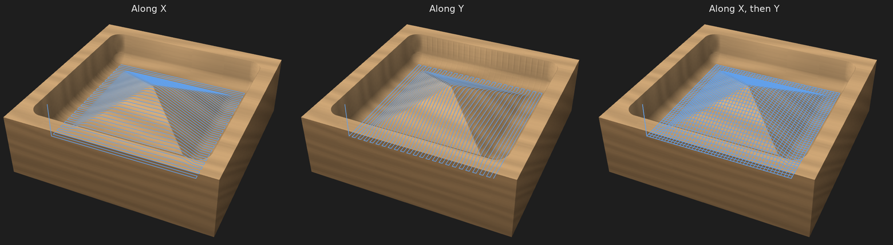

# PutiaCNC: full feature reference

The complete list of what the desktop app does. The README has the short version.

- 2D design canvas: rectangles, ellipses, lines and polygons, SVG and DXF import (File → Import vectors), select / move / resize,
  snapping, undo and redo (Edit → Undo steps back through any change; the toolbar buttons only undo drawing changes), align to the stock and to each other, distribute (the Align button in the tool palette; it is greyed out until something is selected). The node tool (N, or double-click a
  shape) edits its points: drag, add, delete and simplify. Modify → Offset grows or shrinks
  the selected shapes by a distance (inlays, clearances); Modify → Combine shapes does union, subtract, intersect
  and exclude. The text tool (T) turns typed text, in any font
  installed on the computer, into outlines you can profile or pocket, with an angle if you want it turned. The text stays editable:
  click it to select all its letters, double-click it (or press Edit text) to change the words, font, size or place, even after it
  has been moved, scaled, turned or flipped. "To outlines" turns it into ordinary shapes for node editing and trimming; editing the
  letters point by point does that automatically, with a note. A copy made with Duplicate is plain outlines.
- Text window: the text, Font, Height and Align stay on top; Spacing, Layout, Position and Shadow fold away (each remembers whether
  you left it open), and the help sits behind the ? beside Place. The Font menu shows every name in its own letters (long names are
  drawn smaller to fit; fonts that cannot draw their own name show it in plain letters) and has a search box. Spacing: automatic
  kerning from the font (pairs like AV or To pulled together; on by default) and extra space between letters and between words, as a
  percentage of the height. Layout: straight, stacked top to bottom, or along an arc: radius, where on the circle the text sits
  (90° is the top, 270° the bottom) and whether the letters face outwards or the centre, with a warning when the text is longer than
  the circle. Straight text can be fitted to a width: the height follows, and longer text gets smaller letters. Shadow adds a second,
  offset copy of the letters. All of it is saved with the text, so it stays editable.
- Hatch fill (Draw operation): "Fill closed shapes with lines" draws parallel lines across every closed shape (`hatch_lines` in `src/toolpath.rs`). Angle, Spacing (the pen's line width unless set, so the ink just touches; wider leaves paper showing as a lighter shade), Cross-hatch (a second set at right angles) and Outline. Lines are cut where they enter and leave the shapes by the even-odd rule, so a shape inside another is left empty; open lines are drawn as they are. The lines are joined into a zigzag: when the next line starts within 1.6 line spacings of where the last ended and the way across lies inside the shapes (checked at three points), the pen stays down and draws across, so a filled shape is often one stroke. Saved in the operation as `hatch`.
- Repeat and rest (Draw): "Repeat" goes over the whole drawing again (1 to 20 times; the strokes are ordered nearest-first again each time, starting where the pen is, and each round starts with a `(Repeat n of N)` comment). "Rest" is a pause in seconds after every pen-down (`G4 P0.25`); it is left out when a joined stroke keeps the pen down. Saved as `repeat` and `dwell`.
- 2D pen width: with Toolpaths on, the 2D canvas draws what a pen does as a line as wide as the pen (never thinner than one pixel), in the pen's ink colour when it has one and in the operation's colour otherwise. Zoom in to see hatch spacing, overlaps and the width of text strokes. Cutting operations still show a thin line.
- Feeds and speeds by material (`src/feeds.rs`): the Stock section has a Material (softwood, hardwood, plywood, MDF, acrylic, aluminium, foam; "Not set" by default, saved with the project) and the machine editor has a Rigidity (light by default, medium, heavy; saved with the machine). With Custom feeds and speeds on, "Suggest for <material>" fills in spindle speed (the tool's own, held to the material's usual window and to the machine's spindle limits), feed (spindle speed x flutes x a chip load from the material, the diameter, the tool shape and the rigidity, held to the machine's top feed), plunge, stepover and the depth per pass (not for V-bits, engraving bits and drills, whose depth is the design's). The values are the operation's own and can be changed; the line below shows the chip load against the usual range and warns when it is heavy, and notes for the material appear underneath. The numbers are typical starting values for hobby machines to be checked with a test cut, not data from a tool maker. Nothing changes in a project until the button is used.
- Stock appearance: Light wood, Dark wood, Plywood, MDF, Acrylic, Metal, Foam and Paper (for pen drawings), each with its own colours in the drawing and the 3D preview in both themes (grain rings for the woods and plywood, speckle for MDF and foam, brushed streaks for metal). Choosing a Material in the Stock section sets the matching look (softwood: light wood, hardwood: dark wood, aluminium: metal and so on); Appearance can be changed afterwards. The look is only for the screen.
- Pen colour: the tool editor has an "Ink colour" for a pen (a colour button, with a button back to the usual dark ink). It is saved with the tool (`color`, "#rrggbb"), so it travels in libraries and projects. The 3D preview draws the ink of each Draw operation in its pen's colour, and the tool lists show a dot of it beside the pen. It does not change the G-code; a job with several pens still stops (`M0`) at each pen change and names the pen.
- Joining strokes (Draw): "Join gaps under N mm" (saved as `join`) keeps the pen down and draws a straight line to the next stroke when it starts closer than that. An edge that two shapes share exactly (same two end points) is drawn once, and the pieces are chained into longer strokes; strokes with nothing shared are left as they are (`dedupe_edges` in `src/toolpath.rs`).
- Single-line text: the first fonts in the Font list ("Single line · Sans, Sans bold, Roman, Roman bold, Script, Cursive") are the Hershey single-stroke fonts built into the app (`src/linetext.rs`, data in `fonts/hershey`). Each letter is a few open strokes along its centre line instead of an outline, so a Draw operation makes the pen write the text once (a pocket or profile would only follow those lines as if they were cuts). Height is the capital height. Accented letters used in Italian, French, Spanish, German and Portuguese are put together from the plain letter and a mark; other characters are skipped. Kerning does not apply to these fonts.
- Operations: profile (outside, inside, on the line), pocket, V-carve and drill (pecked, nearest hole first), each with its own tool,
  depth, pass depth (defaults to the tool's value), cut direction, ramp-in, air cut and holding tabs
  (automatic or placed by hand on the canvas) and tangent lead-in / lead-out arcs on profiles (the radius shrinks
  to fit, with a note if there is no room). Warns when the depth exceeds the stock thickness.
- Snapping: besides the grid, the pointer jumps to the corners, midpoints, centres and crossings of shapes (and to the stock's corners, edge middles and centre), with a marker and a label. Dragging a selection snaps its corners, edge middles and centre. Toggle with Guides → Snap to shapes or View → Snap to shapes.
- Trim and extend (X): click the part of a shape to remove and it goes up to the nearest crossing on each side (shown in red first; a closed shape needs two crossings and becomes an open path). Switch to Extend and click near the end of an open line to run it on in a straight line to the first shape it meets.
- Fillet and chamfer on chosen corners: in the point editor (N) select one or more points, set Fillet or Chamfer and a size, and press Apply. The Fillet and chamfer window still does every corner of the selected shapes at once.
- Clean up drawing (Modify menu): joins pieces whose ends meet within a tolerance (so an outline drawn as separate lines becomes one closed shape that a pocket can use), removes duplicate and empty shapes, and counts the open contours. Loose ends are ringed on the drawing (red: nothing meets it, amber: another end is within the tolerance); an import with open contours turns them on and says so. Works on the selection, or the whole drawing when nothing is selected.
- Circle mode: in the Ellipse tool, switch Ellipse to Circle (and Radius to Diameter if you prefer) to drag a circle from its centre, or just type the centre X, Y and the size.
- Typed values: with the Line, Rectangle or Ellipse tool, start typing a number. A small panel takes X and Y for a line's first point, length and angle for the next one, or X, Y, width and height for a rectangle or ellipse, or centre, radius and angle for a polygon, star or bolt circle (a point grid takes its corner and size, a drill point its X and Y). Empty fields follow the pointer. The Text window has Start X and Y fields too, and opens with the Text tool, so text can be placed by number as well as by clicking. Tab moves between fields, Enter confirms, Esc cancels.
- Rotate: click an already selected shape again to swap its resize handles for rotate handles (drag a corner; Shift snaps to 15°; the centre mark can be dragged to move the pivot), or type an angle in the Rotate field that floats above the shape. Manual holding tabs turn with their shape.
- Bitmap tracing: File → Import bitmap (or drop a PNG, JPG or BMP on the window) opens a dialog with the picture and the traced result: outlines (closed shapes, holes included, for Profile, Pocket, V-carve and the rest) or centre lines (one open line along the middle of each stroke, for engraving), threshold, invert, size in mm, crop to content, a percentage trimmed off every edge, a filter for specks and optional smoothing. The picture is shown large and the tracing runs in the background, so the window stays responsive while a centre-line trace of a big picture is worked out. The dialog remembers its settings. It works best on logos and silhouettes. For a pen, use centre lines: a Draw operation draws each as one stroke (a thick circle is one closed line, a crossing makes its arms; the ends of a line come out about half a stroke width short), where an outline trace would go round both edges of every stroke (tested with `tests/data/sketch.png`). Tracing uses the `visioncortex` crate (MIT OR Apache-2.0) and `image` (MIT OR Apache-2.0).
- Imported drawings (SVG/DXF, traced bitmaps) are listed in the left panel with position and size fields, Fit to stock, rotate 90° either way, flip horizontally or vertically, and a Lock that stops them being moved, resized or flipped by accident.
- Rulers in mm along the top and left of the drawing area, counting from the XY zero you chose (the pointer and the selection are marked on them) and optional graduated X / Y axes along the stock edges; both are under Guides in the bottom bar.
- A keyboard shortcuts reference (Help menu or F1).
- Inlay: one button makes a pocket operation and a matching plug operation (a mirrored copy of the selection beside it), cut with a V-bit and a flat end mill; depth, tools and the glue gap are editable. The pocket and plug walls slope at the same angle, and the 3D preview shows both.
- Plug on a separate piece: tick "Cut from a separate piece" in the plug operation to cut the plug from its own piece of stock (another wood, another thickness). Set its size, position in the drawing, XY zero, Z zero (stock top, or a height above the piece's bottom) and material there; the plug is mirrored at the pocket's own place on the piece. "Replaces the main stock" (on by default) is for the usual case where you take the main stock off the machine and put the new piece in the same place: the piece then has the main stock's size and work zero, so only its thickness and material are set, the plug file says it replaces the main stock, and the clamps are checked against it too. Switch it off to give the piece its own size and zero. Export writes two files, "name.nc" for the main stock and "name-plug.nc" for the piece, each with its own work zero, so zero the machine again before the second file. The G-code tab switches between the files, 2D shows the piece beside the stock, the 3D preview has a Main stock / Plug piece switch, and the status bar adds up both. The toolpath warnings are worked out for the piece too (marked "plug piece" in the list; Show in 3D switches to it); the clamps are checked on the piece too: a piece that replaces the main stock sits among the same clamps, and a piece that stays beside it stands where it is drawn, so a clamp drawn under it counts.
- Export split: when the project has two or more operations that can stand alone, Export G-code first asks how to split the program: one file (the whole program, the default), one file per tool, or one file per operation. The window lists the files with their times. Each file is complete on its own (spindle on, safe heights, safe end, its own summary), keeps the project's operation numbers, and says at the top what to do before starting it (change the tool and touch off Z0, or "same tool as the previous file"). A tool change or a pause between two files becomes the end of a file instead of an M0, with the pause message kept as a comment. Names are `<project>-<n>-<operation>.nc` or `<project>-<n>-<tool>.nc`; plug pieces stay separate files. The choice is remembered. The G-code tab, the 3D preview and the time estimate still describe the whole job.
- Plotter mode: a pen or marker is a tool of type "Pen / marker" in the tool library (line width, draw speed, pen-down speed). A Draw operation makes it follow the outline of every shape once: pen down at Z0 (or a little below, for a spring-loaded holder: "Pen down"), lifted "Pen up" mm between strokes (2 mm by default), nearest stroke first. The spindle is never started (no M3, M5 or spin-up wait) and nothing is taken off the stock in the 3D preview: the pen's line is drawn as ink, as wide as the pen, as the preview plays. A Draw operation takes only a pen and a cutting operation only a cutter; changing between the two writes the usual stop for a tool change. An air run draws 10 mm above the paper. Set Z0 on the surface of the paper.
- When the tool list has only pens (a pens library is chosen), the Profile, Pocket, V-carve, Drill, Inlay and 3D relief buttons say so in the status bar instead of making an operation that cannot work; Draw says the same when the list has no pen. The box generator then skips its outside cut and says why.
- Round-tipped bits: V-bits, engraving bits and tapered ball noses have a tip radius setting, and V-carve also works with ball noses, so the troughs come out rounded. The 3D preview uses the real cutter shape.
- Drill points (D): click to place points, or drag out a bolt circle, an arc of holes or a columns x rows grid (set them in the bar); assign them to a Drill operation. A point is a real shape: it moves, copies and arrays like any other.
- 3D relief: import an STL or OBJ model (File > Import 3D model; files are read as millimetres, and a dialog shows the model as a height map so you can pick the axis that points up, Y for most OBJ and Z for most STL, or turn it upside down), then add a 3D relief operation: two steps, each with its own tool and options and each switchable: roughing (flat end mill, pass depth, stepover, material left) and finishing (ball nose, stepover) along the surface. The model is reduced to a height map seen from above, so overhangs and undercuts are not carved. Drag the model on the canvas to place it (Shift-drag box-selects over it).
- Polygon and star tool (P): drag from the centre; choose the number of sides or star points and the star's inner radius in the toolbar.
- Default tools include two CMT decorative beading bits. Arc profile bits: round-over, flat-bottomed corner-radius and cove form bits are defined by their arc radius (convex or concave; a convex arc smaller than the bit radius leaves a flat bottom) and work in V-carve, giving rounded or flared troughs. Undercut profiles are not supported.
- Group (Edit menu, Ctrl+G) ties the selected shapes together: clicking one selects them all, and they move, scale, rotate, align and are copied as one thing, and the group is saved with the project. Ungroup (Ctrl+Shift+G) takes it apart. Double-click a shape in a group to edit its points. A group shows a dashed box when it is only part of the selection; a copy of a group is a group of its own.
- Array and copy (Modify menu): repeat the selected shapes in a grid or around a circle.
- The 2D toolbar is in groups (Select and Edit points | drawing tools | Combine, Align, Fillet, Offset, Array and copy | Undo and Redo); in a narrow window it wraps between groups, never inside one. Offset and Array and copy are toolbar buttons too (also in the Edit menu), greyed out until something is selected.
- Fillet and chamfer: a toolbar tool (shown when the selection has corners) that rounds or bevels the corners of shapes.
- Dogbone: the third choice in the Fillet and chamfer window. It cuts a small round relief into each inside corner of the selected shapes, as wide as the cutter: by default the tool of the operation the shapes are in (for the box, the tool a new operation would start with), or untick "Tool of the operation" to type a diameter or pick a tool. The reliefs are made once: if you change the tool afterwards, undo and make them again, so a square corner of another part fits. Inside is for pockets and cut-outs; Around is for parts cut out along the outside that have a notch. Corners wider than 140° or sharper than 5° are skipped. The relief is 0.03 mm wider than the cutter so the toolpath is sure to enter it.
- Messages: every message has a level, and a level has one colour and one sign wherever it appears (`gui/src/msg.rs`): an error is red with a circle and "!", a warning orange with a triangle, news blue with a circle and "i". That covers the banner under the view tabs (which can be dismissed), the bars for toolpath warnings (orange) and for clamp collisions (red, since the tool hits something), the notes under the buttons of the tool windows (orange), the warnings in the panels and the tool manager, the update window's failure, and the rows of the warnings list. The scene's own markers (the red triangle in the 3D view, the red clamps) stay red.
- Nest on the stock (Modify menu, with shapes selected): packs the selected parts onto the stock in rows, tallest first from the lower left corner, to use less material. Set the Gap between parts (6 mm by default: leave at least the cutter's width), the Margin kept free along the stock's edges (3 mm) and whether parts may be turned by 90°. With turning allowed it tries the parts as drawn, all lying flat and all standing up, and keeps the layout that fits the most parts, then the one that uses the least of the stock. A group or a placed text moves as one part, and manual tabs turn with their shape. It works from each part's bounding box, so odd shapes are not interlocked, and the result is the same every time. Parts that do not fit stay where they were, and a note says how many. Undo puts everything back.
- Finger joint (Modify menu, with a rectangle selected): cuts tabs or slots into any of its four edges for plates that slot together. Tabs on one plate and Slots on the plate it meets, on edges of the same length. The fingers are as deep as the stock is thick, there is always an odd number of equal fingers near the width you ask for (so both ends match), and slots are wider than tabs by the clearance (0.05 mm by default). Optional dogbones in the slot corners use the cutter diameter. Everything shows in a preview before you apply.
- Box with finger joints (Generate menu): type the outside width, depth and height (open top, or with a lid) and the plates of the box appear next to your drawing, laid out in rows no wider than the stock. The thickness is the stock's. Along every edge the fingers alternate between the two plates, an odd number of them, and each corner belongs to one plate, so the plates fit with no overlap and no gap apart from the clearance. Optional dogbones, and (on by default) "Create the outside cut": one Profile operation round the outside of every plate, as deep as the stock is thick plus 0.2 mm so it cuts through; pick its tool and tabs in the project panel. Dividers (0 to 10 across the width and 0 to 10 across the depth) stand in slots cut through the walls they meet and the bottom, held by tabs; where one crosses another each is slotted halfway (a half-lap) so they interlock; the box refuses dividers closer than twice the thickness. Relief style: Dogbone or T-bone (the relief goes straight into the longer wall only; corners far from a right angle get a dogbone), also in the Dogbone mode of the Fillet and chamfer window. A test fills a model of the box, dividers included, cell by cell and checks every wall cell is covered exactly once.
- Surface the stock (Generate menu): flattens the top of the stock, or the spoilboard, with a wide flat cutter (the widest one is suggested, a surfacing bit when there is one). It adds an ordinary Pocket operation over a rectangle one cutter radius larger than the stock on every side, so the cutter's edge reaches the stock's edge, with a light pass, a wide stepover (percent of the cutter) and no ramp or tabs. Options: run it before the other operations (default), air cut, and for the spoilboard, make the stock the size of the machine's work area. The "extends beyond the stock" warning is not given for it.
- Rest machining for 3D relief (Finishing step, Detail row): pick a smaller ball nose and, after the finishing pass, it goes only where the finishing ball could not reach. The ball is run over the surface with its tip as low as it can go without gouging, and what is left above the model at each point (the lowest of the ball's surfaces over it, more than 0.05 mm) marks the places: inside corners where slopes meet the floor, grooves narrower than the ball, fine detail. Convex slopes and peaks are not marked, since a ball reaches them. The small ball follows the surface along X over those places (grown by its radius, nearby stretches joined) with its own stepover, lifting between stretches; a note gives the share of the surface it covers, or says the big ball reaches everything. A detail tool that is not smaller than the finishing tool is skipped with a note. It is a third tool slot of the operation: the 3D preview, the checker and the replay of the G-code know it. Saved as `rest` and `dSo`.
- Relief finishing direction (Finishing step, "Lines" row): the finishing lines run along X (the default), along Y, or along X and then along Y. A wall that runs along the lines comes out rougher than one across them, so the other direction, or both for an even surface (twice the cutting time, noted in the program), gives a better finish. The Y lines are the X lines of the surface turned a quarter, cut with the same ball, stepover and rules; each direction starts with a lift and a move across, and the second has a `(Operation n: relief, finishing, second direction)` comment. The detail pass stays along X. Saved as `fDir` (`y` or `xy`; absent = X).

  

- Finishing pass (Profile outside, Profile inside and Pocket, "Finish" row, flat or ball tool): with it ticked the depth passes keep "leave" (0.2 mm by default, up to 2 mm) away from the walls, and one last pass cuts the walls to size. That pass is a single full-depth pass when the tool's flute length (set in the tool library) covers the depth, otherwise it runs at every depth again, each only taking the thin stock off. Cleaner walls, no steps between depths, and a more accurate size, as the last pass is light and the tool has already stopped doing the heavy cutting. Tabs, ramps and lead-in/out apply to both. A pocket's floor is not left oversize, only its walls; the Corners cleanup comes after the finishing pass. When the shape is too narrow for the stock to be left (a slot not 2 x the leave wider than the tool) a note says so and it is cut to size in one go. Saved as `wLeave`.
- Rest machining (Pocket operation, Corners row): pick a smaller flat end mill and, after the pocket is cut with the main tool, it clears only what the main tool could not reach. That is the pocket minus the pocket "opened" by the main tool (shrunk by its radius and grown back), so it is the corners and any part narrower than the main tool, with slivers under 0.2 mm dropped. The smaller tool pockets that area grown by its own diameter and cut to the pocket (a disc touching the leftover reaches that far), at the operation's depth, with its own feeds and a pass depth no deeper than its own. A tool-change stop sits between the two tools like for any other tool. Both tools must be flat end mills and the cleanup tool smaller; otherwise a note says why it was skipped. Tests: the leftover of a rectangle is four corners of (1 - pi/4) r squared, a slot narrower than the tool is all left, the cleanup path stays inside the walls and reaches the corners.
- A pocket the main tool is too wide for (nothing fits) is cut whole by its Corners tool when one is set; the notes say so (information, not a warning): which tool was too wide, how wide the shape is, and that the Corners tool does the whole pocket. With no Corners tool, or one that is too wide as well, the no-toolpath message below applies.
- Why there is no toolpath: when a Pocket or Profile inside produces nothing, the message says why, operation by operation. A shape narrower than the tool gives the tool's width, the shape's width at its narrowest, and the biggest tool of the same kind in the project that does fit; open lines in a pocket are named as such. The general advice (attach closed shapes to an operation) is only given when nothing more specific is known.
- A default tool library with 23 common hobby-router tools (flat, downcut, compression, ball nose in inch and metric sizes, V-bits, engraving, surfacing); cautious starting speeds and feeds. The tool manager estimates the chip load and material removal rate from the speeds, feed and pass depth.
- Ready-made tool libraries in `libraries/`: `cmt.json` (CMT, 159 bits), `amana.json` (Amana Tool, 418 bits from its CNC booklet), `bosch.json` (Bosch PRO, 31 bits), `freud.json` (Freud, 170 bits from its 2020 General Purpose catalog) and `whiteside.json` (Whiteside, 33 bits from its CNC brochure), `diablo.json` (Diablo, 9 bits) `generic.json` (brand-neutral standard sizes, 77 bits: end mills, compression, ball nose, V, engraving, taper, surfacing, round-over) and `pens.json` (16 pens and markers for Draw operations, under the tool group "Pens": fineliners 0.1 to 0.8 mm, ballpoint, gel pens, permanent markers, paint markers, a bold marker). They are built into the app: Tool manager → "Add a ready-made library" adds the ones you want (the same files can also be loaded with Import); each is its own library, with duplicates (such as coated twins and shank variants) merged inside it. Dimensions come from the makers' websites and booklet; speeds and feeds are conservative starting values, not the makers'. `gen_bit_libraries.py` regenerates them and `amana_extract.py` and `freud_extract.py` read the Amana and Freud PDFs.
- Remembers window size and position, panel layout, view toggles, last folders and recent files (File → Open recent) between sessions. A window too narrow for the side panels and a usable drawing (a tiling window manager can make one) hides the operations panel first, then the project panel, and brings them back when there is room; the panel buttons in the title bar show a hidden panel as off, and clicking one shows it in place of the other.
- A Notes tab with free-form project notes (saved with the project), plus the generator's warnings.
- `cargo run --release --example sign` builds a sample sign and times toolpath generation and the 3D replay. `--example docproject   <out.json>` builds the project used for the README screenshots (they use the demo version of the E-SQUARE font, name "E-SQUARE"; the font is not in the repository), and `--example optimes <project.json>` prints when each operation starts and ends in the job.
- Toolpath accuracy: offset paths are thinned to within 0.02 mm of the true offset (Douglas-Peucker, measured against the original, not step by step). Before this, a big smooth shape such as a 100 mm ellipse got chords up to 0.23 mm off, so an outside cut went 0.23 mm into the part, and the "Tool cuts past the design" warning was right to say so. The G-code of curves is somewhat longer (the sample snapshots grew by 1.5 to 2 times).
- The toolpath is worked out beside the window, so editing stays smooth on big jobs (the status bar shows "generating…" when it takes a moment); saving and exporting always use the toolpath of the current drawing. 3D relief toolpaths use all the processor's cores.
- 2D + 3D: a third tab beside "2D design" and "3D preview" shows the drawing and the 3D preview side by side, with a draggable divider between them and one bottom bar for both: Grid and Snap on the left, playback (restart, play, slider, time, speed) in the middle, the Toolpaths and Rapids checks and Guides on the right (in a narrow window playback moves to a second row of the same bar). Edits show in 3D as the toolpath is regenerated. Zoom and fit keys (F, +, -) go to the view the pointer is over; Fit to stock in the View menu fits both. Choosing "Show in 3D" from the G-code list or a warning keeps the split instead of switching away from it. The Preview checkbox of the tool windows still shows its result in the 2D side. On a busy toolpath (140,000 moves) an idle frame of the split view costs less than the 2D view alone in the test project.
- The 3D preview replays the program in short slices, so switching to it never freezes the window; a progress badge shows while it catches up.
- Stock appearance (light wood, dark wood, metal or foam) in the drawing and the 3D preview.
- 3D view cube: in the corner of the 3D preview, click a face (Top, Front, Right, Back, Left), an edge (a 45 degree view) or a corner (isometric) and the camera glides there and fits the stock; drag the cube to orbit; the Persp./Ortho icon pair sits below it (hover for a description).
- 3D bottom bar: one bar with restart, play, the progress slider and the time on the left, then Toolpaths, Rapids and the playback speed (where Guides is in 2D). In a narrow window the toggles move to a second row under the playback row.
- Zoom card: in both the 2D design and the 3D preview, a small card with − , the zoom percentage, + and Fit. 100% is the fit view of that window; click the percentage for a menu (Fit, 25% to 800%). Keys: + / = zoom in, − zoom out, 0 fit (F also fits in 3D); trackpad pinch zooms too. In 2D the card stays in the top right corner (the toolbar leaves room for it); in 3D it is part of the view cube card, and Fit sits in the Persp./Ortho row.
- Shortest path order (always on): the shapes of an operation are cut nearest first instead of in drawing order, and a pocket is cleared region by region, so the tool travels less between them. Parts inside another part are still cut before it. There is no switch: the order never depends on how the shapes were drawn. On the test projects the rapid travel drops from 3026 mm to 426 mm (two operations) and from 197 mm to 139 mm (parts with holes).
- Ramp in for pockets: a pocket operation with "Ramp in" ticked eases the tool down instead of plunging straight down. Only the rings next to the walls ramp, from the depth of the previous pass; with a stepover of 45 % or less the rings inside them drop straight into the slot already cut (through air) and cut flat, and every ramped ring gets a flat lap so the floor is level at each depth. With a larger stepover every ring ramps. In an inlay, "Ramp in" is on the Flat row, because it is the flat end mill that ramps: along the rings that clear the pocket floor and along the cut-out of the plug.
- Helical entry (Pocket, Profile outside and Profile inside): the tool goes down in a spiral beside the start of the first ring of a pocket (round islands included) or of the profile, instead of plunging or ramping along the path. The Circle row sets the spiral's diameter as a percentage of the tool (100 % by default) and the Angle row the slope (3 degrees by default); a flat turn clears the floor of the hole and the cut goes on from the same point. The circle sits on the waste side, tilts away from a corner, and shrinks until it fits; where nothing fits, that path enters as the Ramp in setting says and a note says so. In a pocket the rings inside the first still drop into the slot already cut. A profile's spiral makes a hole in the waste, like a lead-in. It takes priority over Ramp in where both are ticked (Ramp in then serves the rings inside a pocket's first ring, and the paths where the spiral does not fit), and it is ignored where a lead-in/out arc is set, and the passes that cross a tab keep their own entry. A test checks the slope and that a pocket with an island ends up the same as without the spiral.
- Adaptive clearing (Pocket, row under Helical entry): a light stepover (12 % of the tool by default, from 2 to 40) instead of the tool's own, and the corners of every ring inside the first rounded off, so the tool does not meet a wedge of material where a ring turns sharply. Parts of the pocket too thin to survive the rounding keep their own ring, so the pocket is cleared as before; a test compares the stock with and without. It does not follow the material left by the previous pass the way commercial adaptive toolpaths do: it is the same rings with a lighter, smoother cut, best with a larger pass depth (up to the flute length) and a machine with an acceleration setting.
- Custom feeds and speeds: tick "Custom feeds and speeds" in an operation to use another spindle speed, cutting feed, plunge feed or stepover than the tool's, for that operation only (an inlay operation, which cuts with a V-bit and a flat end mill, gets one block for each tool; a 3D relief has one inside its Roughing box and one inside its Finishing box, with Spindle, Feed and Plunge only, because those steps already have their own stepover fields). Feed and plunge are shown in the speed unit of the tool library window (stored in mm/min). The fields start at the tool's values; a value you change turns blue, shows what the tool has ("tool: 800") and gets a reset button, and values you leave alone keep following the tool. The machine's limits still apply (with the usual warning), the summary line, time estimate and 3D replay use the custom values, and a different spindle speed between two operations with the same tool writes a new M3 S line without a tool change. Unticking the box goes back to the tool's values and forgets the custom ones.
- Pause afterwards: tick "Pause afterwards" in an operation (with an optional message such as "Flip the stock") and the program, when that operation is done, lifts to safe Z, stops the spindle and waits with `M0 ; message` until you resume it in your sender (a semicolon comment, because gSender drops comments in brackets before sending and shows the semicolon ones; Mach3 gets `M0 (message)`, as it has no semicolon comments). After the resume the next operation starts the spindle again, with the spindle wait, so nothing cuts before it is up to speed. The message is plain ASCII (no brackets), at most 80 characters; an empty message becomes "Operation N done: resume when ready". "What this will do" lists the pauses. A new operation does not copy the pause of the one before. Touch off Z0 again after the pause if you flipped the stock or changed anything that moves it.
- The G-code names the tool in the spindle (`(Tool: 6 mm flat end mill)`, after every tool selection) and each pass (`(Pass 2)`, `(Pass 3, levelling lap)`), as comments that senders ignore. A program stops for a tool change whenever another tool entry is needed, even one of the same diameter (before, GRBL programs only stopped when the diameter changed, so a V-bit and a flat end mill of the same size did not). These comments let the 3D preview play the G-code text itself (`src/replay.rs`).
- Machine G-code output: GRBL, grblHAL, FluidNC or Mach3 / LinuxCNC. grblHAL and FluidNC write exactly what GRBL writes for now (only the first comment names them); they exist so a machine keeps its controller and later changes (controller messages, M6 tool changes, probing) have somewhere to attach.
- The G-code starts with a summary in comment lines (zero, start, tools, tool-change reminder, pauses, depth and time, end, air cut, warnings): the same text as the "What this will do" box, so whoever opens the file at the machine can read it. Comments only; senders and the 3D preview ignore them.
- The 3D preview plays the G-code text: it stops at every `M0` (a pause or a tool change) with the message on the screen until Play is pressed, shows the wait for the spindle, and draws the cutter faded while the spindle is off. In the G-code tab the line the preview is at is highlighted and the list follows it; clicking a line takes the preview to that point.
- Spindle wait: a machine has a "Spindle wait (s)" setting (default 2 s, 0 = none), the pause after the spindle starts before the tool touches anything; a spindle that needs longer to reach speed can say so. The program waits the same time when it only changes the speed (two operations with the same tool at different rpm). The wait is part of the time estimate.
- Tool change on a GRBL machine: the program stops with `M0 ; Change tool to 6 mm, then touch off Z0 and resume`, and "What this will do" adds a warning row, because GRBL does not know how long each tool is and every depth after the change depends on Z0 being set again.
- Your own G-code per machine (Libraries > Machines): lines added after the setup lines at the start and, after the spindle stops and the return to X0 Y0, at the end of every program for that machine; a note in the G-code tab says so.
- An operation that loses its last shape (you deleted it to redraw it) stays, with all its settings, and the status bar says so once. Select the new shapes and press "Use selected shapes" in the operation (shown in the active operation, and in any operation without shapes); the same button moves shapes from one operation to another. The trash icon on the operation removes it.
- Operation badges: shapes that belong to an operation carry a small numbered badge in the operation's colour beside their top-left corner (shapes of one operation that lie close together, such as the letters of a text, share one), so the link does not rest on colour alone. View → Operation badges on shapes hides them.
- Show or hide operations in the 3D preview: the eye on each operation (shown while the 3D preview is open) leaves it out of the replay and the time line; the choice is saved with the project. The G-code still contains every operation.
- Clamps: each clamp in the left panel folds away, and the eye beside the Clamps heading hides them in the drawing and the 3D preview (the warnings still check them).
- Selecting a shape outlines its operation in the Operations list and scrolls the list to it (shapes without an operation outline nothing).
- Tool manager search: type words (name, type, size, notes; all must match) above the tool list; matching groups open by themselves, Esc or Clear shows everything again.
- Acceleration in the time estimate: a machine has an "Acceleration (mm/s²)" setting (Grbl's `$120`; 0 = off, the default) and a "Corner deviation (mm)" (Grbl's `$11`, 0.01 by default). With an acceleration the time estimate and the 3D playback let the machine speed up and slow down at that rate and take each corner at the speed the deviation allows, the way Grbl's planner does, and start from rest after a spindle start, a dwell or a tool change. Long straight cuts are hardly affected; jobs of many short moves (relief finishing, small text, tight curves) take noticeably longer, as they do on the machine. The "Time correction ×" still multiplies the result: setting an acceleration for the first time puts it back to 1. The G-code does not change.
- Time by operation: click the estimated time in the status bar to see where it goes: one row per operation (with its colour, a bar, the time and the share of the total), the wait for the spindle, and the total. Each bar is solid for cutting and faded for moving between cuts (rapids, plunges, retracts); hover a bar for the two numbers. The plug pieces are included, and the rows add up to the status bar. Pauses for you (M0) and tool changes by hand take no time, as in the estimate itself.
- Toolpath warnings: after every change the program is checked on a background thread. Static checks: deeper than the tool's cutting length, below the bottom of the stock, outside the machine area, more stock than Z travel. Simulation checks: a rapid move through material, the shank rubbing the walls (set Cut length and Shank dia. in the tool manager; 0 switches those off), the tool entering a clamp (Clamps under Stock: X, Y, width, length and rise above the stock; drawn red in the 2D view, where you can drag them with the mouse, and as boxes in the 3D preview; a clamp the toolpath runs into turns solid red with the same warning sign as the 3D preview in the 2D view, and its tooltip names the operation). The warnings are in a bar under the view tabs (the first one in words, "and N more", a List button for the whole list and Show in 3D; it cannot be dismissed and is there while the warnings are; the status bar only says "checking…" while they are worked out); Show in 3D jumps the preview to the move and marks it with a warning sign. It also compares the toolpath with your drawing: a shape narrower than the tool (which gives no toolpath at all) and a cutter that strays more than 0.2 mm past the line (flat, bull, ball, arc and cone tools, V-bits included, judged by the width they cut at that depth), for example parts closer together than the tool's width cut by separate operations. The G-code is always written; the warnings only inform. The tool holder is checked too, if you want it (off by default; it is not part of the tool checks until you switch it on): tick "Tool holder" in the machine settings, give Holder dia. there (the collet nut or spindle nose, whatever hangs lowest; the value is kept when you untick it) and Stick-out in the tool manager (how far the tip stands below the holder; the field only appears while the holder is on); when both are known, "Tool holder hits a clamp" is raised for a move where the holder's underside is lower than the top of a clamp and the holder reaches over it (for example a rapid at safe height past a tall clamp with a short stick-out). 0 means unknown and switches that check off for that tool. With the holder off nothing about it is checked or drawn. In the 3D preview the tool is then drawn as long as it sticks out, with the holder above it as a see-through cylinder. While the replay is running, a clamp the cutter or the holder is in the way of turns solid red, the part that touches (holder, or cutter) turns red, and a red banner names the clamp ("The tool holder runs into Clamp 1"); it follows the clamps' eye, so with the clamps hidden nothing is flagged in the picture (the warnings still check them). A clamp the toolpath runs into also gets a bar under the view tabs ("Operations 1 and 2 run into Clamp 1", with Show in 3D) for as long as it happens; the List button's count and list still include it.
- Speed units in the tool library: the speeds follow the "Show lengths in" switch, mm/min with mm and in/min with inches, so a metric user looking at an imperial tool only has to switch the lengths to mm to read everything in metric (selecting an imperial tool switches to inches, as before). "Speeds in" picks any other unit (mm/s, m/min, in/s, ft/min) and is remembered separately for the mm view and the inch view. Older preference files keep their unit. The custom feeds block of an operation uses the same unit.
- The GRBL header sets units, absolute mode, the XY plane, feed per minute (`G94`) and the first work coordinate system (`G54`), so nothing is left over from an earlier job or a console command.
- Every program lifts the tool to safe Z (`G0 Z..`) right after the header, before the spindle starts and before anything moves sideways, so it does not matter at what height the tool was left after zeroing. (Earlier versions started with a sideways move at whatever height the tool was at.)
- Every program is read back before you see it, by a checker that works from the text of the G-code alone (it shares no code with the generator): a cutting move with the spindle off, a feed move with no feed set, a spindle started without a speed, a number that is not a number, a first sideways move before the tool height is set, or a spindle left running at the end each give a warning in the Notes tab. The tests run the same checker on every sample project in many variants (Mach3, inches, numbered lines, arcs, air cut, ramps, 3D relief, inlay, plug on its own piece) and compare the cutting length and depth it measures from the text with what the generator counted.
- What this will do: the top of the G-code tab has a short summary in plain words, read from the generated program: where the zero is, what the first moves do (a warning when the program does not lift the tool before its first sideways move), which tools it uses and where it pauses for a tool change, how deep and how long it cuts, how it ends, which operations are air cuts, and how many warnings there are (see the Notes tab). It can be folded away and follows the Main piece / Plug piece choice and the inch setting.
- Libraries for tools and machines, with imperial and metric tools. A machine holds its work area, rapid rate, G-code dialect (GRBL or Mach3 / LinuxCNC), G-code units (mm or inches), line numbers, arcs (G2/G3), safe Z and optional limits (spindle min/max rpm, max feed, max plunge): a tool that asks for more is held to the limit in the G-code, with a warning. Machines can be exported to and imported from a file.
- 3D preview: GPU ray-marched height field of the stock with the toolpath, rapids and cutter
  marker, and a play bar to replay the job.
- Help → Check for updates asks GitHub for the latest release and offers to download it (an AppImage can replace itself). It only contacts GitHub when you ask, or at startup if you tick that option.
- G-code tab with a time estimate and warnings, optional output in inches, optional line numbers (N10, N20, ...), and a choice of GRBL or Mach3 / LinuxCNC G-code (tool changes as `T1 M6`, safe-start line, `G54`, `M30`).
- Unsaved-changes prompts, native file dialogs, light and dark themes.

## Setup assistant

The first time the app runs (no settings file yet) a five-step assistant asks for the units, the machine (picked from a list), its details (a size class to start from, then travel, rapid speed, feed/plunge/spindle limits, controller and rigidity) and which starter tools to add (straight end mills in metric or inch sizes are always included; V-bits, ball nose, surfacing and pens are optional). On the first run it replaces the default machine and the tools of the current library; **Help → Setup assistant…** runs it again later and only adds a new machine and a new library "My tools". The size classes are round figures, not product specifications: check the machine's manual.

The assistant is one fixed-size window over a dimmed program, with a blue panel at the left (what the program is, and "Step n of 4") and the step at the right. Units are two large cards with a ruler; the machine step is a searchable grid of cards (maker, model, work area; "Other / not listed" first); the details step has a card that draws the work area to scale, lets you rename the machine and shows the work area, spindle and controller, with every value (size class for a machine that is not listed, travel, rapid rate, limits, controller, rigidity) below it. The tools step is four tick cards, and the last step a summary of machine, units and tools with Start.

### Machine catalogue

The setup assistant's machine step starts with a search and a grid of the catalogue (20 machines: Carbide 3D Shapeoko 5 Pro, FoxAlien, Genmitsu and NymoLabs), which fills in the travel, the maker's top speed as the rapid rate and the supplied spindle's top speed, and keeps the product page on the machine's notes. **Libraries → Machines → From catalogue** adds one to the machine list at any time. The data is `libraries/machines.json`: figures come from the makers' own pages, a field is left out where the maker publishes none, (the one exception is the acceleration: makers do not publish it, so five machines carry the factory `$120` that owners posted from their own settings listings, with the page it was read from on the machine's notes; the time estimate then models the acceleration and the correction is 1), and a top speed is never turned into a cutting-feed limit. The stiffness (light / medium) is our own estimate. Two FoxAlien models (Masuter 3S, XE-Ultra) do not name their firmware on the maker's page; GRBL is assumed and noted on the machine.

- Fractions (View > Units > Fractions, inches only): lengths from 1/16 in up are shown as the nearest 1/64 of an inch (`2 1/4`, `3/16`), in fields, readouts and messages; smaller values (tolerances, passes under 1/16 in) stay decimals. A field that is clicked starts with the exact decimal unless the value is an exact fraction, so leaving it as it is changes nothing. Fields accept fractions (`1/8`, `1 3/16`) and typed units whatever the setting.

- Long names: an imported file's name, a 3D model's name and the tool and file lines of an operation card end in an ellipsis (the whole name is the tooltip) instead of widening the panel. A number field that is clicked and left with its text as it was does not change the value (it used to round it to the decimals shown, which made the reset arrow appear).

- Tool windows: Box generator, Finger joint and Combine have OK (does it and closes the window) and Cancel; Offset, Array and Fillet and chamfer have Apply (does it and stays open, to go again) and Close.

## Quick tour

Help → "Quick tour" (also offered at the end of the setup assistant) walks through the
window in 8 short steps: tools, left panel, operations panel, view tabs, time and checks,
G-code, and what to do next. The rest of the window is dimmed and the part being explained
is outlined. Next/Back, Enter/arrow keys, Esc or "Skip tour" to leave.

## Sample projects

Generate → Sample projects offers three samples (the last page of the setup assistant offers the name plate). The **name plate** is a small plate (cut-out with tabs, a shallow recess and engraved lettering) made to fit the machine and tools in use: the stock and the plate are sized to the work area, the depths stay inside the Z travel, the cutters come from your tool library (a V-bit or engraving bit for the lettering when there is one), and the sizes are round numbers in your units. The Notes tab explains the sample and how to try it as an air cut first.

An air cut runs 10 mm above the stock, or deeper-operation depth + 2 mm when that is higher (a 12 mm cut-out runs 14 mm up), so even its lowest move stays 2 mm above the stock. Nothing is removed in the 3D preview: turn on "Toolpaths" to see the moves.

The **finger-joint box** is the five plates of an open box with finger joints (fingers twice the material thickness, dogbone reliefs for a round cutter) laid out in rows on the stock, with one outside cut through all of them with holding tabs. The box is as large as the stock takes it (up to 80 x 60 x 40 mm), the plates are cut from the stock's own thickness (6 mm, or 1/4 in, or less on a machine with little Z travel), and the Notes tab explains how to change it with Edit → Box with finger joints.
The **3D relief** is a six-petal rosette (up to 60 mm square and 6 mm high, made by the program from a formula, so no model file is needed) carved in one Relief operation: the widest flat end mill up to 6.5 mm roughs it in layers, the largest ball nose up to 7 mm finishes it, and the next smaller ball nose is the Detail tool that finishes the dimple in the middle and the corners where the petals meet the floor. A project without a ball nose gets the 1/8 and 1/4 inch ones of the starter set added, and the notes say so; with only one ball nose there is no detail pass and the notes say how to add one. Test: `relief_sample_fits_every_machine` (five machines, metric and inch: the model stays on the stock, roughing and detail both cut, no warnings).

## Setup sheet

File → Setup sheet… saves one printable page for the person at the machine and opens it in the browser, where it can be printed or saved as PDF. It has the job in numbers (machine, stock, material, where X0 Y0 and Z0 go, estimated time, cutting length, safe height) beside a picture of the stock with the shapes in the colour of their operation and the work zero marked, the tools in the order they are used (type, diameter, speed, feed, plunge, which operations use them), the operations (depth, pass, tabs, air cut, pauses, time each), a tick-box list of what to do before starting (including the tool-change, pause and air-cut reminders), the toolpath warnings, any separate pieces of stock with their own zero, and the project notes. Lengths and feeds are in the display units. The page is a single file with no outside links.

